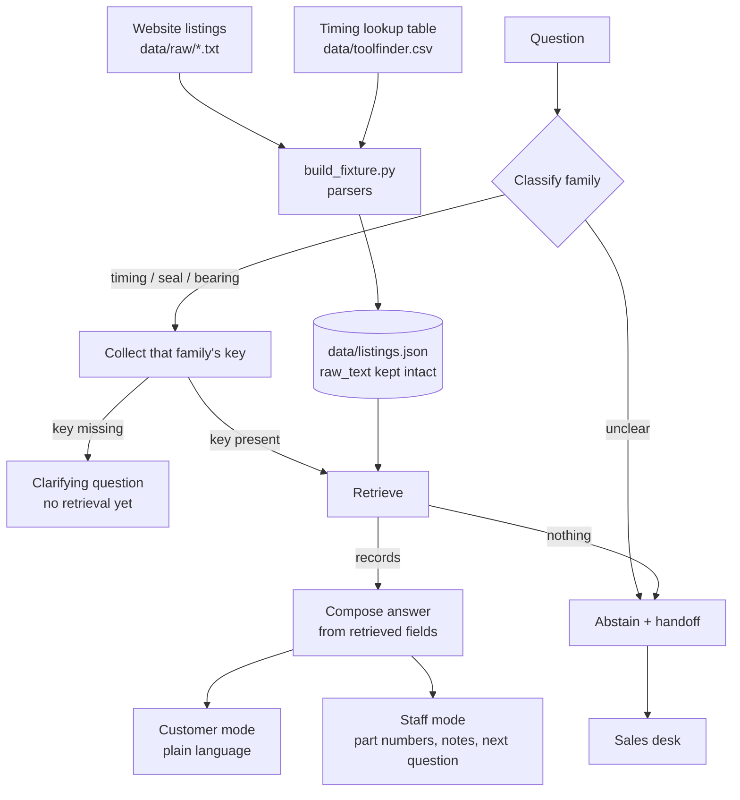

# Ozwide Tools - Fitment Assistant (mock-up)

Mock-up for **COSC2960 Foundations of AI, Assignment 3**.

A retrieval-augmented assistant that answers specialty-tool fitment questions from the
Ozwide Tools product catalogue. Two audiences: trade customers, and internal sales staff.

It runs **fully offline with no API key**. Nothing here calls a paid platform, and the
demo does not touch the live website.

---

## 1. Run it

Requires Python 3.10 or newer. Everything else is open source and installs with pip.

```bash
python -m venv .venv
# Windows: .venv\Scripts\activate    macOS/Linux: source .venv/bin/activate
python -m pip install -r requirements.txt
python -m streamlit run app.py
```

Streamlit prints a local URL (normally <http://localhost:8501>). Open it, press a button
under **Demo scenarios**, and the whole exchange plays out.

No internet connection is needed after `pip install`. No key, no account, no subscription.

### Tests

```bash
python -m pytest tests -v
```

75 tests, no network. They cover family classification, key collection, each match type,
every abstain path, and the rule that no answer can name a part number that is not in the
fixture.

---

## 2. Why retrieval, and what it is retrieving

The catalogue changes weekly, so an answer from model memory would be wrong the moment a
listing is edited. Answers are therefore assembled **only** from retrieved records.

Two sources, deliberately different in shape:

| Source | Shape | Role |
|---|---|---|
| `data/raw/*.txt` - website product listings | semi-structured free text | the bulk of the catalogue |
| `data/toolfinder.csv` - timing lookup table | structured, 5 rows | **authoritative** for engine timing where a row exists |

The table is keyed on **make + engine code only**: no model, no year, no displacement. So the
system has to work out which family it is answering before it knows what to ask for.

### The fixture is small on purpose

8 records: 3 full listings, 2 timing-table tools, 3 tools that are only cross-referenced
from a listing. It is not the 10-15 the design brief suggested, because every extra SKU
would have had to be **invented**, and inventing part numbers is exactly the failure this
product is built to avoid. Scope is declared in the sidebar rather than padded.

What it does **not** cover: the live catalogue, prices other than those three listings,
stock levels, delivery, torque settings, or any make outside the three families below.

---

## 3. How a question is handled



The match key changes per family, which is the point of the design:

| Family | Match key | Vehicle alone enough? | Must ask for |
|---|---|---|---|
| Timing | engine code, cross-checked against the CSV | only if the code is known | engine code |
| Seal | OEM seal number, else installed depth | no | seal number, or depth |
| Universal bearing | measured diameter | **no** - it is a measurement | inside/outside diameter |

`retrieval.py` exposes these as pure functions, testable without Streamlit:

```python
classify(question) -> "timing" | "seal" | "bearing" | None
missing_fields(family, slots) -> list[str]
lookup(family, slots) -> list[Record]
turn(question, ...) -> Turn   # classify + collect + retrieve + decide, in one object
```

`Turn.status` is `answered`, `clarify` or `abstain`, and `Turn.reason` records why.
The reply states its own provenance in plain English ("Matched on the engine code CXSA…"), so
the workflow is visible in the conversation itself. There is also an optional pipeline panel
for the report appendix - see [§5a](#5a-optional-retrieval-evidence-panel-off-by-default).

---

## 4. No invented part numbers - and this is enforced, not promised

Every answer is passed through `answer.assert_skus_known()`, which scans for SKU-shaped
tokens and raises if one is not in the fixture:

```python
def assert_skus_known(text: str, fixture: dict) -> None:
    allowed = known_skus(fixture)
    for sku in skus_in(text):
        if sku not in allowed:
            raise UnknownSkuError(...)
```

`compose()` runs it on every answer before returning, and the test suite runs it across
every scenario in both modes. To see it fail on purpose:

```python
>>> import answer, retrieval
>>> answer.assert_skus_known("The tool you need is DM11-X9999.", retrieval.load_fixture())
UnknownSkuError: answer mentions DM11-X9999, which is not in the fixture.
```

The misspelt companion `DM1-A1872` is kept as an **alias** of `DM11-A1872` rather than
corrected in the source text, so the assertion accepts the published spelling while the
typo stays visible.

---

## 5. Two modes

| | Customer mode | Staff mode |
|---|---|---|
| Part number and price | yes | yes |
| Plain-English reason for the match | yes | yes |
| Negative constraints ("NOT for 4BE") | yes | yes |
| Internal match type and matched fields | no | yes |
| Data-quality flags on the listing | no | yes |
| Alternatives and companion tools | short form | full form |
| "Ask the customer next" | no | yes |

### 5a. Optional retrieval evidence panel (off by default)

The mock-up shows the interaction, so the pipeline panel is **not drawn by default** — the
conversation is full width and the reply carries its own plain-English reason.

The panel is still implemented and still records its data on every turn. To bring it back
(useful for a report appendix or a marker who wants to see the decision path):

```bash
# macOS / Linux
FOAI_SHOW_EVIDENCE=1 python -m streamlit run app.py

# Windows (bash / git-bash)
export FOAI_SHOW_EVIDENCE=1 && python -m streamlit run app.py

# Windows (cmd / PowerShell)
set FOAI_SHOW_EVIDENCE=1
```

That restores the side panel *and* its "Show retrieval evidence" sidebar toggle. Nothing else
changes, and no code needs editing. When shown, it is a **marker view**: a real customer would
not see it, so it is labelled as such in Customer mode.

---

## 6. The optional LLM path (off by default)

The demo path is deterministic templates. The LLM path exists to support the section of the
report that discusses generative answering, and it is disabled unless both of these are set:

```bash
export FOAI_LLM_MODE=deepseek
export DEEPSEEK_API_KEY=...          # never committed, never in a file
```

With the flag off, no API client is imported and no network call is possible.

When it is on, the generated text is **also** put through `assert_skus_known()`. If the model
invents a part number, the answer is rejected and the deterministic template is used
instead. If the call fails, the same fallback happens silently. A live model can therefore
never widen what the system is willing to say.

---

## 7. Data quality: the mess is encoded, not cleaned

The listings are reproduced in `data/raw/` byte for byte - `tests/test_fixture.py` asserts
they still match the fixtures they were built from. The defects below are parsed **around**,
and several are surfaced to staff at answer time.

| Defect | Where | How it is handled |
|---|---|---|
| Companion tool written `DM1-A1872` and `DM11-A1872` | listing 1 | alias table; both resolve, neither is scrubbed |
| Title advertises 1.0L but no 1.0L codes are listed | listing 1 | parsed as-is; flagged to staff |
| "Other Engine codes" block sits after two blank lines | listing 1 | parser continues past blank lines inside the block |
| Codes with no displacement attached | listing 1 | stored with `displacement: null`; cannot narrow on size |
| `Izuzu` misspelt, Colorado filed under Isuzu | listing 2 | kept; flagged to staff |
| Model year embedded in model name | listing 2 | kept verbatim in `model_lines` |
| One seal number published four ways | listing 2 | all published forms normalise to a key; the `8-` form is a genuinely different digit string and is kept, not "fixed" |
| `Will NOT fit 4BE` | listing 2 | parsed as a negative constraint, shown to the customer |
| Alternative kit named, its depth never published | listing 2 | the answer says the depth is not published instead of implying one |
| Inside and outside diameters with no stated rule | listing 3 | both accepted; a mismatch between what the customer measured and which table the value appears in is surfaced explicitly |

That last one is the clearest demonstration of why retrieval beats a language model here: a
model would confidently pick a diameter. This system returns the adapter, notices the side
does not match, and says so.

---

## 8. What the screenshots show

`screenshots/` was captured from this app running locally, not mocked up. They show the
interface as it ships: no evidence panel.

| File | Scenario |
|---|---|
| `01_timing.png` | Timing happy path: engine size narrows to 10 codes, engine code resolves to a kit |
| `02_seal.png` | Seal ambiguity: two near-identical kits, separated by seal number or depth |
| `03_bearing.png` | Bearing kit matched on measurement, with no claim of vehicle fitment |
| `04_abstain.png` | Out-of-catalogue vehicle refused, no SKU offered, handoff |
| `05_timing_table.png` | The timing table outranking the listing |
| `06_abstain_push.png` | Customer pushes after a refusal; the refusal holds |
| `07_staff_mode.png` | Staff mode: match type, data flags, what to ask next |

If you want the pipeline panel in a screenshot for the report appendix, re-run with
`FOAI_SHOW_EVIDENCE=1` and capture again.

---

## 9. Layout

```
foai-a3-mockup/
  app.py                  Streamlit UI: two modes, scenario playback, optional evidence panel
  retrieval.py            classification, slot extraction, key matching (pure functions)
  answer.py               template answers, SKU assertion, optional LLM path
  build_fixture.py        parses data/raw + CSV into data/listings.json
  data/raw/*.txt          the three listings, byte-for-byte as supplied
  data/toolfinder.csv     the timing lookup table, unchanged
  data/listings.json      generated - do not hand-edit
  tests/                  pytest: fixture integrity, retrieval, answer guards
  screenshots/            captured from the running app
  DEMO.md                 the four scenarios verbatim, and a recording script
  requirements.txt        pinned
```

`data/listings.json` is generated. After editing anything in `data/raw/` or the CSV:

```bash
python build_fixture.py          # rebuild
python build_fixture.py --check  # verify the committed file is current
```

---

## 10. Known gaps

- **Sales phone number.** `answer.STAFF_HANDOFF` is a placeholder that points at the contact
  page rather than quoting a number, because the fixture holds no phone number and inventing
  one would break the project's own rule. Replace it with the real public line before the
  pitch.
- **Three families only.** A fourth family would need its own match key and parser.
- **No real embeddings.** Matching is deterministic on structured keys and text fields,
  which is a deliberate choice for a demo that must run offline on a lab machine. The report
  should describe this as key-based retrieval over a normalised index, not as a vector search.
